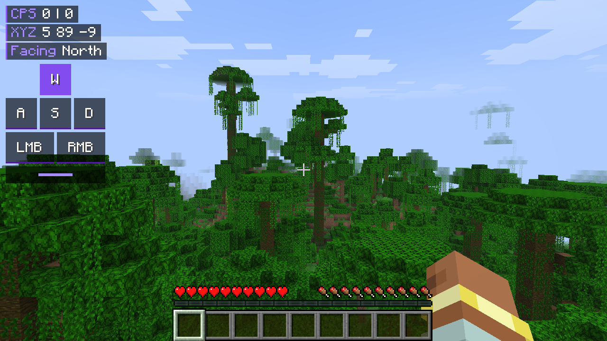
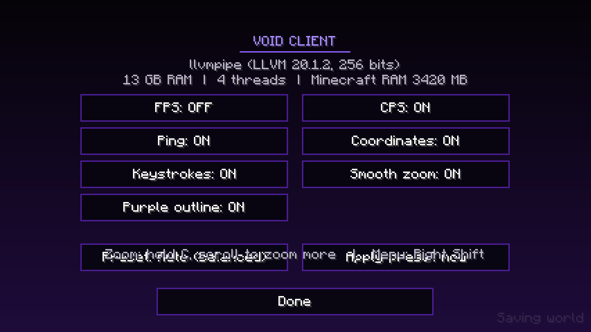

# Void Client

A free Minecraft 26.3 client that boosts FPS on weak laptops, with a purple-and-black Lunar-style HUD, zoom and Simple Voice Chat.

It works on any laptop. The first time it starts, Void Client checks your graphics card, RAM and CPU and picks the right settings by itself:

| Preset | Picked for | Render distance | FPS cap |
| --- | --- | --- | --- |
| Potato | Built-in graphics with under 7 GB RAM (for example Dell Latitude 3520 with 4 GB) | 6 | 60 |
| Balanced | Built-in graphics with 8 GB+ RAM, or a graphics card with under 12 GB RAM | 10 | 120 |
| High | NVIDIA / AMD graphics card with 12 GB+ RAM (for example Dell G16 7630) | 16 | Unlimited |

You can change the preset any time in the Void Client menu (**Right Shift**).





## What's inside

| Mod | What it does |
| --- | --- |
| Void Client | Auto-tuned settings, HUD (FPS, CPS, ping, coordinates, keystrokes), zoom, Right Shift menu |
| Sodium | Much faster chunk rendering (the big FPS boost) |
| Lithium | Faster game logic |
| FerriteCore | Uses a lot less RAM (fixes the "0 FPS for a few seconds" freezes) |
| ImmediatelyFast | Faster HUD, text and entity drawing |
| Entity Culling, MoreCulling | Skips drawing things you can't see |
| Dynamic FPS | Drops FPS when Minecraft is in the background so your laptop stays cool |
| Simple Voice Chat | Proximity voice chat on servers that have it installed |
| Fabric API, Cloth Config | Libraries the mods above need |

## Will this get me banned?

It shouldn't. Everything here is performance, visuals you already have, or info about yourself, the same kind of thing big servers like Hypixel allow:

- No X-ray, reach, autoclicker, kill aura, fullbright, freecam or minimap radar
- Void Client never sends anything to servers
- Coordinates hide themselves on servers that turn on "reduced debug info"
- Zoom, keystrokes, CPS and FPS displays are the same kind of features Lunar and OptiFine have

Every server makes its own rules, so if a server lists banned mods, give it a quick check.

## Install

1. Go to **[getvoidclient.com](https://getvoidclient.com)** and click **Download for Windows**.
2. Close the Minecraft Launcher, open `VoidClient-Installer.exe` and press **Install**.
   - If Windows says "Windows protected your PC", click **More info → Run anyway**. That shows for new apps that aren't code-signed.
3. Open the Minecraft Launcher, pick **Void Client** next to the Play button, and press **Play**.

The installer:
- needs no admin rights and only writes to your user folder
- adds a Fabric 26.3 version and a **Void Client** profile to the normal Minecraft Launcher, keeping your other profiles
- downloads every mod straight from Modrinth and checks each file's SHA-512 hash
- gives Minecraft the right RAM for the laptop (2 GB on 4 GB laptops, 3 GB on 8 GB, 4 GB on 12 GB and up), which fixes the freezes on low-RAM laptops
- keeps Void Client in its own folder (`%APPDATA%\.voidclient`), so your normal Minecraft is untouched, and copies your server list over
- updates cleanly when you run a newer version, without touching worlds, settings or mods you added yourself

### Tips

- **School laptop:** plug in the charger, set Windows power mode to **Best performance**, and close Chrome before playing.
- **Gaming laptop:** if Void Client says "Running on built-in graphics", go to Windows Settings → System → Display → Graphics, add the launcher's `javaw.exe` and set it to **High performance**.

### Prism Launcher or Modrinth App

Download [`VoidClient.mrpack`](site/VoidClient.mrpack) and import it as a new instance. Set the instance memory to 2048 MB on a 4 GB laptop, 3072 MB on 8 GB, or 4096 MB on 16 GB.

## Controls

| Key | Action |
| --- | --- |
| Right Shift | Void Client menu: turn HUD parts on or off, change preset |
| C (hold) | Zoom. Scroll while holding to zoom more or less |
| V | Simple Voice Chat menu |
| Caps Lock | Push to talk (Simple Voice Chat default) |

All keys can be changed in Options → Controls → Key Binds.

## For developers

Needs Java 25, Go 1.24 and Python 3.

```
tools/build-site.sh              # builds the mod, the .mrpack and the Windows installer, then fills site/
./gradlew runClient              # runs the game with Void Client and every mod in the pack
./gradlew runClientGameTest      # in-game automated test (presets, zoom, CPS, menu) plus promo screenshots
python3 pack/build.py lock       # update pack/mods.lock.json to the newest 26.3 versions
```

- `src/` is the Void Client Fabric mod.
- `pack/` holds the mod list (`pack.json`) and the exact pinned versions (`mods.lock.json`).
- `installer/` is the Windows installer (Go, no dependencies besides `golang.org/x/sys`). `-silent` installs without a window, and `-minecraft-dir` and `-game-dir` point it at test folders.
- `site/` is the website for getvoidclient.com. Upload the whole folder to Netlify.
- `branding/` has the icon source (`make_icon.py`) and a 1024 px master.
